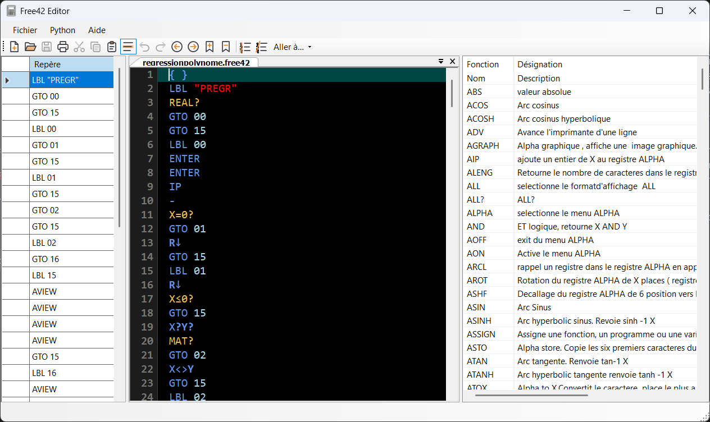
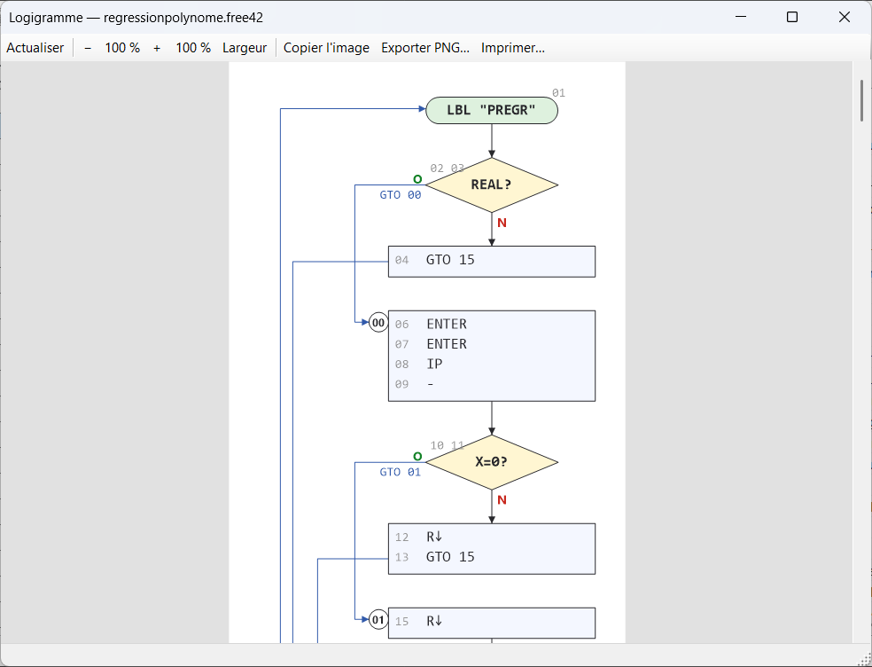
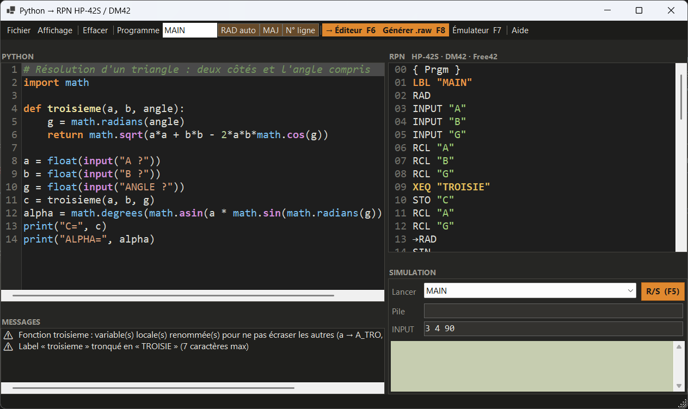

# DM42 / C47 Editor

Éditeur Windows de programmes pour calculatrices **SwissMicros DM42**, **HP-42S**, les émulateurs **Free42 / Plus42**, et pour la **C47 / R47**.



## Fonctions

- **Édition RPN** avec coloration (fonctions, nombres, chaînes, tests, commentaires), numéros de ligne, repères, rechercher / remplacer, impression, thème clair ou sombre.
- **Encodage / décodage** des fichiers `.raw` de la DM42, avec un visualiseur octet par octet (ligne, code RPN, commentaire, octets, erreur).
- **Logigramme** à la manière des feuilles de programmation HP-41C : losanges pour les tests (O / N), blocs d'instructions, appels `XEQ` à double barre, entrées / sorties en parallélogramme, colonne de commentaires. Mis à jour pendant la saisie.
- **Conversion HP-41C → DM42** de la syntaxe (registres de pile, arguments à deux chiffres, etc.).
- **Python → RPN** (Py42) : écrire le programme en Python, obtenir le listing HP-42S et le simuler avant de l'envoyer.
  Avec la cible **C47 / R47** (liste « Cible » de la fenêtre Python), le programme est produit pour la C47 :
  structures `IF` / `DO` / `FORᵀᴼᴾ` au lieu des `GTO`, variables locales dans les registres `LocR` (récursivité permise),
  noms HP-42S convertis (`42α`, `42ARCL`, `42AVIEW`, `42KEY`…). F5 l'exécute dans le simulateur C47, F6 l'ouvre dans un
  onglet C47, F8 l'enregistre en .p47, F7 l'envoie à l'émulateur C47.
- **RPN C47** : des onglets C47 dans le même éditeur (Fichier > Nouveau programme C47, ou ouverture d'un `.p47` / `.p47u`) ; coloration, erreurs signalées pendant la saisie, liste des instructions par domaine (aussi dans Aide > Instructions C47), « Encoder et enregistrer en .p47 » et visualisation des octets (voir [C47/README.md](C47/README.md)).
- **Aide à la saisie** : infobulle sur le mot survolé (instruction, registre `R07`, indicateur `F01`, nombre, remarque…),
  autocomplétion dès deux lettres avec une courte description, et recherche par nom ou description au-dessus de la liste des fonctions.
  Pour la C47 : barre de symboles (→ ⇄ ≤ ≥ ≠ × ÷ ² ˣ √ π…), remplacement pendant la frappe (`->` → `→`, `<>` → `⇄`, `<=` → `≤`,
  `^2` → `²`, sauf dans les textes et commentaires), et écritures au clavier acceptées (`x<>y`, `abs`, `STO*`).
- **Envoi vers l'émulateur** Free42 / Plus42 (F7), dont le chemin se règle dans les paramètres.
- Aide intégrée : liste des fonctions HP-42S et documentation PDF dans une visionneuse WebView2.

| Logigramme | Python → RPN |
|---|---|
|  |  |

## Compiler

Prérequis : Windows, [SDK .NET 10](https://dotnet.microsoft.com/download), runtime WebView2 (fourni avec Windows 11).

Le projet s'appuie sur deux dépôts voisins, attendus dans le même dossier parent :

```
dm42_editor/
├── dm42editor/   ← ce dépôt
├── Py42/         ← compilateur Python → RPN (Py42.Core)
└── dm42dll/      ← encodeur / décodeur .raw (.NET Framework 4.7.2)
```

1. Cloner les trois dépôts côte à côte (`Py42` avec une majuscule, nom attendu par le projet) :

   ```bash
   mkdir dm42_editor && cd dm42_editor
   git clone https://github.com/philgerm57/DM42Editor.git dm42editor
   git clone https://github.com/philgerm57/py42.git Py42
   git clone https://github.com/philgerm57/dm42dll.git dm42dll
   ```

2. Compiler **d'abord dm42dll** : dm42editor utilise `..\dm42dll\bin\Debug\dm42dll.dll`.
   Il faut le [pack de développement .NET Framework 4.7.2](https://dotnet.microsoft.com/download/dotnet-framework/net472) (ou Visual Studio avec la charge de travail .NET desktop).

   ```bash
   dotnet build dm42dll/dm42dll.csproj -c Debug
   ```

3. Compiler l'éditeur (Py42.Core est compilé au passage) :

   ```bash
   dotnet build dm42editor/dm42editor.slnx -c Release
   ```

Les manuels PDF (DM42, HP-42S) ne sont pas fournis : téléchargez-les sur les sites de SwissMicros et de HP,
puis placez-les dans `dm42editor/data/` (`dm42_user_manual.pdf`, `42s manuel utilisation.pdf`, `Quick Reference Guide.pdf`).

Un profil de publication en fichier unique est fourni : `dotnet publish -p:PublishProfile=FolderProfile`.

## Langue

L'interface existe en français et en anglais : Fichier → Paramètres → Langue (par défaut, la langue de Windows). Le changement s'applique au démarrage suivant. Les traductions sont dans `resources/lang_en.txt`, sous la forme `français TAB anglais`.

## Licence

GNU GPLv3. L'encodeur / décodeur `dm42dll` est une adaptation en C# du code TypeScript de J. Heilingbrunner
([vscode-hp42s-Free42](https://github.com/Heilingbrunner/vscode-hp42s)), sous licence MIT (voir `LICENCE.txt` de dm42dll).

HP-42S est une marque de HP Inc. ; DM42 est un produit SwissMicros. Ce projet n'est affilié à aucune de ces sociétés.
