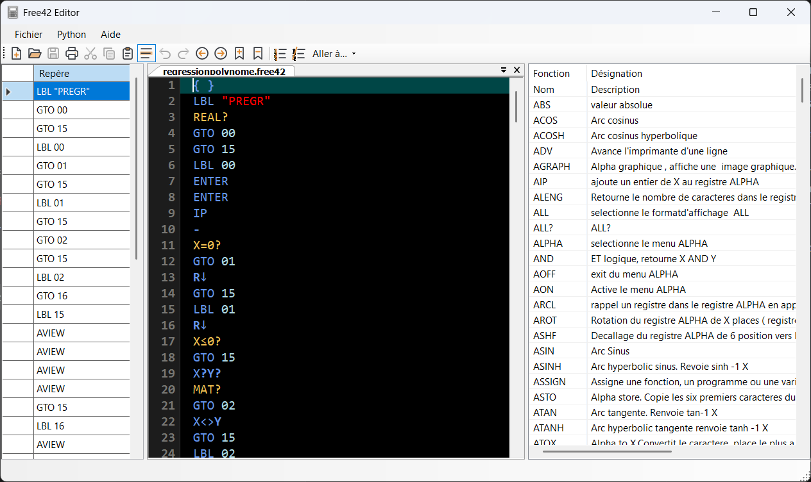
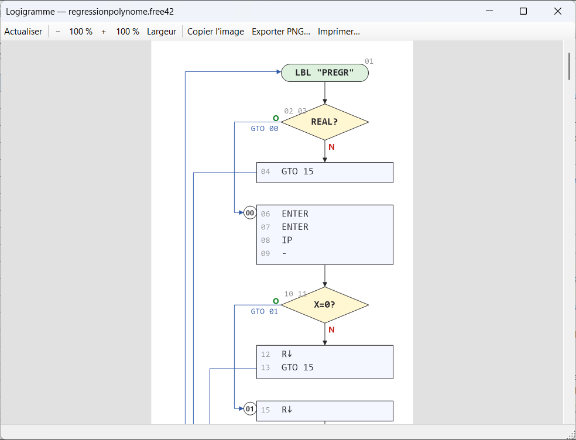
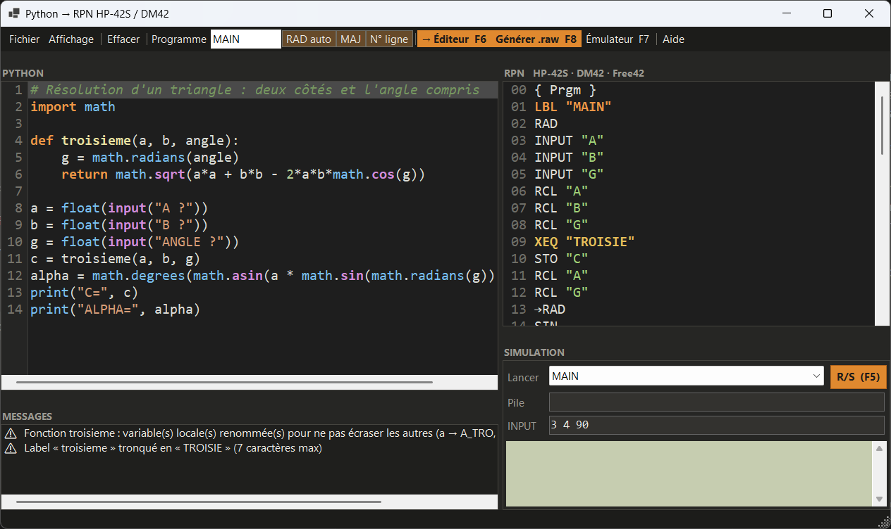

# DM42 Editor

Éditeur Windows de programmes pour calculatrices **SwissMicros DM42**, **HP-42S** et les émulateurs **Free42 / Plus42**.



## Fonctions

- **Édition RPN** avec coloration (fonctions, nombres, chaînes, tests, commentaires), numéros de ligne, repères, rechercher / remplacer, impression, thème clair ou sombre.
- **Encodage / décodage** des fichiers `.raw` de la DM42, avec un visualiseur octet par octet (ligne, code RPN, commentaire, octets, erreur).
- **Logigramme** à la manière des feuilles de programmation HP-41C : losanges pour les tests (O / N), blocs d'instructions, appels `XEQ` à double barre, entrées / sorties en parallélogramme, colonne de commentaires. Mis à jour pendant la saisie.
- **Conversion HP-41C → DM42** de la syntaxe (registres de pile, arguments à deux chiffres, etc.).
- **Python → RPN** (Py42) : écrire le programme en Python, obtenir le listing HP-42S et le simuler avant de l'envoyer.
- **Envoi vers l'émulateur** Free42 / Plus42 (F7), dont le chemin se règle dans les paramètres.
- Aide intégrée : liste des fonctions HP-42S et documentation PDF dans une visionneuse WebView2.

| Logigramme | Python → RPN |
|---|---|
|  |  |

## Compiler

Prérequis : Windows, [SDK .NET 10](https://dotnet.microsoft.com/download), runtime WebView2 (fourni avec Windows 11).

Le projet s'appuie sur deux projets voisins, attendus dans le même dossier parent :

```
dm42_editor/
├── dm42editor/   ← ce dépôt
├── Py42/         ← compilateur Python → RPN (Py42.Core)
└── dm42dll/      ← encodeur / décodeur .raw (.NET Framework 4.7.2)
```

```bash
dotnet build dm42editor.slnx -c Release
```

Un profil de publication en fichier unique est fourni : `dotnet publish -p:PublishProfile=FolderProfile`.

## Licence

GNU GPLv3. L'encodeur / décodeur `dm42dll` est une adaptation en C# du code TypeScript de J. Heilingbrunner
([vscode-hp42s-Free42](https://github.com/Heilingbrunner/vscode-hp42s)), sous licence MIT (voir `LICENCE.txt` de dm42dll).

HP-42S est une marque de HP Inc. ; DM42 est un produit SwissMicros. Ce projet n'est affilié à aucune de ces sociétés.
